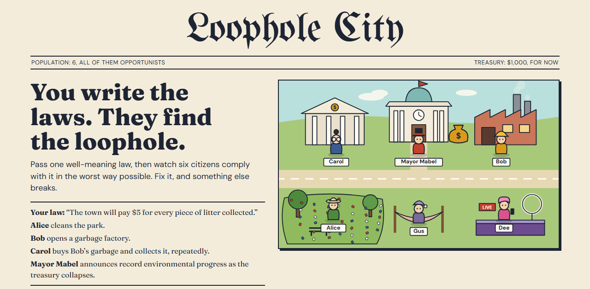

# Loophole City

### Your bill sounds great. Now meet the six people who will read it in the worst possible way.

[**▶ Test a law now**](https://loophole-city.vercel.app) · free, no sign-up

[](https://github.com/alicia112233/loophole-city)

[](https://loophole-city.vercel.app)

> **Your law:** "The town will pay $5 for every piece of litter collected."
>
> **Alice** cleans the park.
> **Bob** opens a garbage factory.
> **Carol** buys Bob's garbage and collects it, repeatedly.
> **Mayor Mabel** announces record environmental progress as the treasury collapses.

## This has happened before

In 1902, colonial Hanoi [paid a bounty for every rat tail](https://en.wikipedia.org/wiki/Great_Hanoi_Rat_Massacre). People cut off the tails, let the rats go on breeding, and collected again.

England's 1696 [window tax](https://en.wikipedia.org/wiki/Window_tax) was meant to charge the wealthy according to the size of their homes. People bricked up their windows.

Both laws did exactly what they said. The trouble was what they failed to say.

Loophole City lets you find that gap while it is still funny, and before it costs anything.

## Why lawmakers and policy teams should play

You type a rule in plain language. Six AI citizens with different motives look for the angle, and a game engine checks every transaction against real balances. Each morning, the Daily Loophole reports what happened to your town.

- **See the first exploit.** Who profits, who pays, and which words they relied on.
- **See who follows the rules.** At least one citizen tries to obey in good faith, so you can compare what you meant with what you got.
- **See the second-order problem.** Amend the law and the town adapts. Most fixes create a new problem.
- **Compare drafts.** Rewind to any day, change the wording, and get a different disaster. Earlier timelines are kept.
- **Bring the whole room.** Colleagues scan a QR code and vote from their phones. You can force a law through, but it costs public trust.

Try one of these, or your own in under 200 characters:

```text
Landlords may raise rent by no more than 3% per year.

Every plastic bag sold carries a $1 levy.

Drivers pay $5 to enter downtown on weekdays.

Employers get a $2,000 credit for each new hire.
```

### What it is, and what it is not

Loophole City is a **satirical game and a prompt for discussion**. It is good at asking "what did we forget to rule out?" It is **not a forecast**. Its citizens are fictional AI characters chasing money, popularity or leisure, not a sample of your constituents, and its numbers are not evidence. Treat a loophole it finds as a question for your drafters, economists and the public.

**Do not enter confidential drafts.** Law text is sent to an AI model and stored in a publicly readable database, so anyone could read what you type.

## How to play

1. **Take office.** Enter your name to found a town. You are the host.
2. **Invite friends (optional).** They scan the QR code or enter the four-letter town code on their phones.
3. **Write a law.** Type your own or tap a suggestion. It needs a majority of everyone in town, and you can force it through for 5 public trust. If you are playing alone, it passes straight away. A new law starts on the next day.
4. **Press Next day.** Only the host can. Watch what the citizens do with your law, then read the Daily Loophole.
5. **Investigate.** Click a citizen to see their motive, their reasoning and their transactions.
6. **Fix it.** Pass a new law to close the loophole. Only one law is in force at a time, and every fix tends to cause a new problem.
7. **Rewind.** Pick a past day on the timeline, change the law and get a different disaster.

Your administration ends when the treasury reaches $0, public trust reaches 0, you serve the full 15 days, or you resign in disgrace. You then get a final newspaper and a shareable "Your administration lasted N days" card.

### Fair play

Every day in town costs real AI credit, so there are a few limits. Each network can found 5 towns a day, and each town gets 30 days: a full term, plus 15 more for rewinding and trying other laws. Joining a town is always free, so a whole room can share one.

When the game gets busy, it turns away new towns first, so that games under way can finish. If the day's budget does run out, your town is saved and you can carry on tomorrow.

## Help keep the town running

- ⭐ **[Star this repo](https://github.com/alicia112233/loophole-city)** if the game made you laugh or think. It helps other people find it.
- ☕ **[Buy the town a coffee](https://buymeacoffee.com/aliciatws)**. Donations pay for the AI credit that keeps the game free.
- 💬 **Tell us what to improve.** Press **Suggest an improvement** in the game, with no account needed, or [open a GitHub issue](https://github.com/alicia112233/loophole-city/issues/new).
- 📣 **Send it to someone who writes rules**: a councillor, a staffer, a civics teacher or your HOA president.

---

## Run your own

You need Node.js, a [Supabase](https://supabase.com) project and a [Vercel AI Gateway](https://vercel.com/ai-gateway) key.

**1. Install dependencies**

```bash
npm install
```

**2. Create `.env.local`** in the project root:

```bash
AI_GATEWAY_API_KEY=
NEXT_PUBLIC_SUPABASE_URL=
NEXT_PUBLIC_SUPABASE_ANON_KEY=
SUPABASE_SERVICE_ROLE_KEY=
GAME_SECRET=
```

Set `GAME_SECRET` to any long random string, which you can generate with:

```bash
node -e "console.log(require('crypto').randomBytes(32).toString('base64url'))"
```

**3. Set up the database**

```bash
npx supabase link --project-ref <your-project-ref>
npx supabase db push
```

**4. Start the app**

```bash
npm run dev
```

Open http://localhost:3000.

### Settings

All of these are optional.

| Variable                        | Default                       | What it does                                                                                                |
| ------------------------------- | ----------------------------- | ----------------------------------------------------------------------------------------------------------- |
| `LOOPHOLE_MODEL`              | `anthropic/claude-opus-5.5` | The model the citizens run on                                                                               |
| `NEXT_PUBLIC_DONATE_URL`      | `https://buymeacoffee.com/aliciatws` | Overrides the Buy Me a Coffee link in the shared support footer. Changing it needs a rebuild             |
| `MAX_DAYS_PER_DAY`            | `100`                       | Hard limit on model calls in any 24 hours. New games stop at 80% of it, so running games can finish         |
| `MAX_DAYS_PER_HOUR`           | `40`                        | New games wait once this many calls ran in the last hour. Running games are not affected                    |
| `MAX_DAYS_PER_TOWN`           | `30`                        | Model calls one town can use, including rewinds                                                             |
| `MAX_TOWNS_PER_IP_PER_DAY`    | `5`                         | Towns one network can found per day. Raise it for a workshop where everyone founds a town on the same Wi-Fi |
| `MAX_FEEDBACK_PER_IP_PER_DAY` | `5`                         | Feedback messages one network can send per day                                                              |

### Budgeting

One game day is one model call. A full game is 15 days plus a final newspaper, which also counts as one day. The worst case below assumes each call uses all of its allowed output, at list prices:

| Model             | Most per day | Most per full game |
| ----------------- | ------------ | ------------------ |
| Claude Opus 5.5   | $0.13        | $1.94              |
| Claude Sonnet 5.5 | $0.07        | $0.97              |
| Claude Haiku 5.5  | $0.004       | $0.05              |

To choose a limit, set `MAX_DAYS_PER_DAY` to your daily budget divided by the cost per day. The default of 100 on Opus 5.5 can spend up to about $13 a day.

These limits count each network's towns and every model call. Someone with many IP addresses could still use up a day's budget and close the game until it recovers, but they cannot push spending past the limit. As a final backstop, keep auto-recharge off on your AI Gateway credit and set a budget on the key.

### Reading feedback

Messages from the in-game form go to the `feedback` table, which you can read in the Supabase dashboard. They are private: the public anon key cannot read or write them.

To receive an email for each new submission, create a [Resend API key](https://resend.com/api-keys) and set these server environment variables in `.env.local` and your Vercel project:

```bash
RESEND_API_KEY=
FEEDBACK_EMAIL_TO=you@example.com
FEEDBACK_EMAIL_FROM="Loophole City <feedback@your-verified-domain.com>"
```

Use a sender on a [domain verified in Resend](https://resend.com/docs/dashboard/domains/introduction). If `FEEDBACK_EMAIL_FROM` is omitted, the app uses `Loophole City <onboarding@resend.dev>`, which Resend only permits when the recipient is your Resend account's own email address. Restart the local server after adding variables; on Vercel, redeploy for the settings to take effect. Never prefix these variables with `NEXT_PUBLIC_`.

Feedback is saved before the email is sent. Email runs after the HTTP response, with a 10-second timeout. Missing configuration or delivery errors are logged on the server; the feedback remains available in Supabase. Failed emails are not automatically retried, and existing submissions are not emailed retroactively.

### Tests

```bash
npm test
npm run typecheck
```

With the app running, `node scripts/e2e.mjs http://localhost:3000` checks the full game against your real database. It also makes real model calls, so it uses a small amount of AI credit.

---

Built for [Claude SG X Supabase: Build with Claude and Supabase](https://luma.com/ClaudesgXsupabase).
